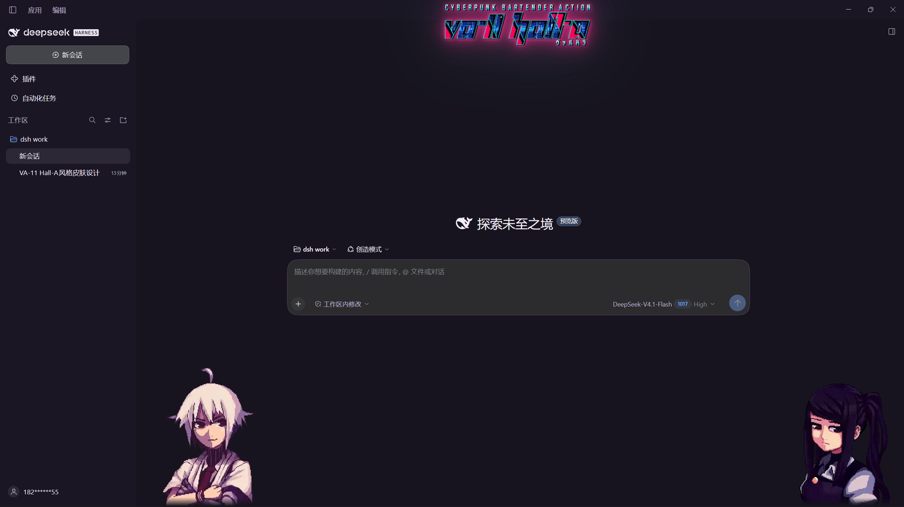

# VA-11 Hall-A Skin

A **DeepSeek Harness (DSH) Web UI skin plugin** themed after *VA-11 HALL-A: Cyberpunk Bartender Action*.



- Near-black purple palette with neon magenta accents (dark only)
- Official **VA-11 HALL-A** logo sign with a neon glow, centered above the conversation
- **Dana** and **Jill** character art framing the chat (click-through, never blocks the UI)
- Rotating-free tagline under the composer: `TIME TO MIX HARNESS AND CHANGE LIFE`
- Embedded assets: no external files, CDN or font install required

## Install

Drop the package into the DSH profile and add the bundle row via the Plugin Manager:

```
plugin_manager install_bundle <absolute path to this directory>
```

The plugin row is named **VA-11 Hall-A Skin**. Disable it to restore the stock UI.
The skin forces the dark appearance (its light token set is dark as well).

## Layout

| File | Purpose |
| --- | --- |
| `package.json` | Bundle manifest (`dsh.bundle.patch`, `dsh.client`) |
| `cordis.patch.yml` | Loader row |
| `index.js` | Host half (no-op) |
| `client.js` | Generated client module (art, logo and font embedded as base64) |
| `client.template.js` | Source template with asset placeholders |
| `generate_client.py` | Build step: inlines `assets/*` into `client.js` |
| `assets/` | Character art, logo, Share Tech Mono (OFL) |
| `icon.svg`, `locale/` | Plugin icon and display metadata |

Rebuild after changing the template or assets:

```
python generate_client.py
```

## Disclaimer

This is a non-commercial fan project. *VA-11 HALL-A: Cyberpunk Bartender Action* and all
character artwork, logos and names are © Sukeban Games. The bundled character art and
the game logo are used here for personal, non-commercial fan purposes only; they are not
covered by this repository's license. The Share Tech Mono font is licensed under the
SIL Open Font License. No affiliation with or endorsement by Sukeban Games or DeepSeek
is implied. Rights holders may request removal of the artwork at any time.
